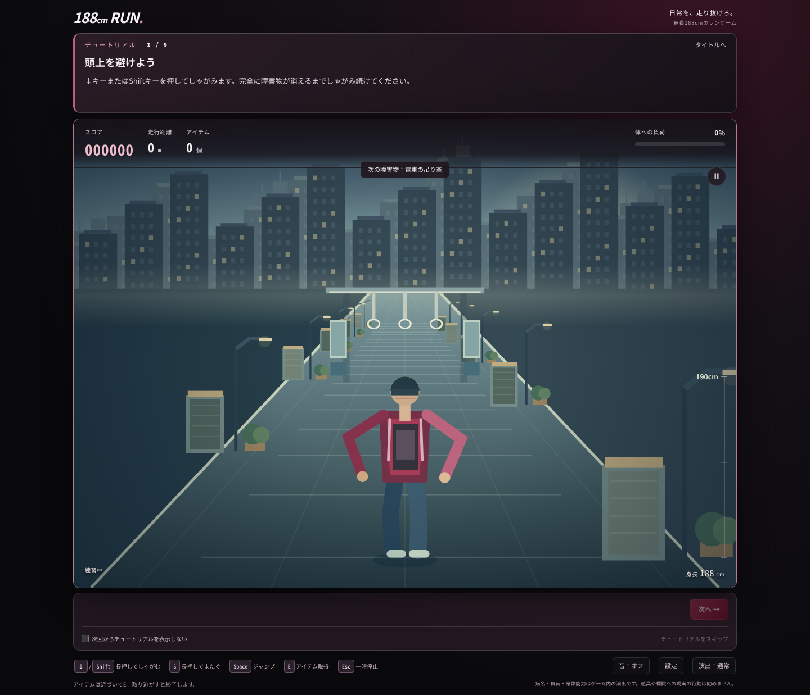
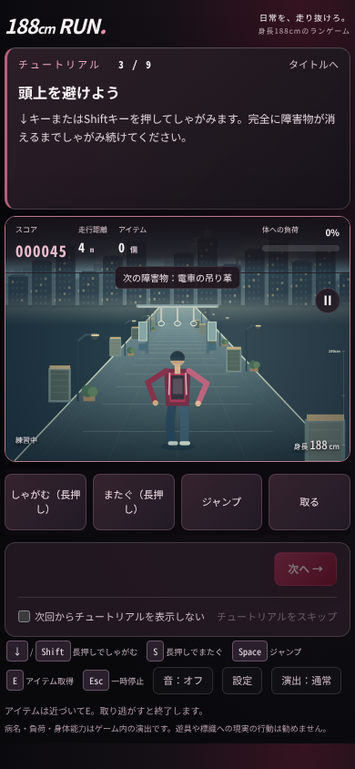

# 追加修正20〜22：チュートリアルの視認性と効果音

2026年10月13日。PR #3をマージしたmain（`b38d118`）を引き継いだ追加修正です。[前回の統合アップデート](UPDATE_REPORT.md)の内容を維持しています。

## 説明文の配置

説明文をCanvasの上の固定高エリアへ移し、進行ボタン・フィードバック・スキップ設定をCanvasの下に分けました。通常時も同じ上部領域に操作のヒントを表示するため、説明文の切り替えやレッスンの文章量でCanvasの位置・大きさが変わりません。黒×バーガンディのガラス風デザイン、12px以上の文字、折り返しを維持。スマートフォンでもHUD・障害物名・キャラクター・アイテムと重なりません。

Canvasの論理座標960×680、カメラ、半透明条件、障害物、入力、衝突、疲労、速度、出現バランスは維持。PCは説明欄の高さを考慮しつつ横幅を確保（1440×1080でCanvas幅1150px以上）。スマートフォンのCanvas幅・縦横比は維持し、低い横長画面では極端な縮小を避けます。

チュートリアルは元の9段階の順序・障害物のままで、新しい長押し区間は追加していません。しゃがみの説明は次の全文をそのまま表示します。

> ↓キーまたはShiftキーを押してしゃがみます。完全に障害物が消えるまでしゃがみ続けてください。




## 効果音と設定

`audio.js`にオリジナルのWeb Audio API合成音を追加しました。外部音源・追加通信・有料素材・APIキーは使いません（約8KB）。短い三角波とフィルター付きノイズを使用し、音源の出典確認が必要な録音素材はありません。

- 足音：左右の接地を交互に検出。速度から周期を積分し、描画と同じ位相を使います。しゃがみは周期を0.82倍、またぎは0.60倍にし、音量も抑えます。
- ジャンプ：入力が受理された瞬間に踏み切り音。空中では足音を止め、地面に戻った物理ステップで別の着地音を鳴らします。
- 取得：`tryGrab()`で取得が成立した瞬間だけ鳴ります。予約中のEも対応。高いアイテムは少し高い音色です。
- 姿勢：しゃがみ・またぎ・立ち戻りの変化時だけ衣擦れ音を鳴らし、長押し中の繰り返しはありません。
- 失敗：衝突・疲労・取り逃がしを区別します。通常の衝突と短い終了音は1つの音声内で順に鳴らし、同じゲームオーバーに別の終了音を重ねません。チュートリアルの衝突は短い衝突音のみ。
- UI：スタート・リスタート・ランキング・設定に控えめなクリック音。

「設定」で効果音のON/OFFと0〜100％の音量を変更できます。設定はブラウザに保存されます。初期値はオフ・音量30％。「音：オフ」ボタンから直接オンにもできます。保存済みのオン設定でも、ページ読み込み時にはAudioContextを作らず、ユーザーのタップ・キー操作後に開始します。`webkitAudioContext`の代替にも対応。保存領域や音声APIが利用できなくてもゲームは継続します。

同時再生は最大6音、足音は最大1音。マスター音量に余裕を設け、音量100％でも6音の最大ゲイン合計が1未満になるようにしています。使い終えた音源・ノードは停止して切断。イベントキューも16件に制限。一時停止・ミュート・音量ゼロ・ゲームオーバーで動作音を停止し、遅いフレームから古い足音をまとめて再生しません。

## 追加15項目の確認

| 項目 | 確認と結果 |
| --- | --- |
| 1〜3 説明の非重複・前方の見やすさ・PC/スマートフォン | 全9段階の説明文がCanvas外に収まることをDOM座標で検証。1440×1080・390×844・320×568・1280×720・横長844×390で折り返し・横はみ出しを確認。PC/スマートフォン画像を目視確認。 |
| 4〜5 指定文・順序 | しゃがみ全文の完全一致、9段階の実キー通過、最後の5イベントの順序を確認。 |
| 6 速度と足音 | モデルの低速・最高速で接地間隔と左右交互を確認。 |
| 7〜8 空中停止・踏み切り/着地 | 実キー・タッチ操作で空中の足音数が増えず、1秒のジャンプに1回の踏み切り/着地が出ることを確認。長押し再発音なし。 |
| 9 取得成功のみ | 低い/高い取得・早いE予約・空振り・再取得のモデル検証と、実E/タッチ取得、実キーでの325cm予約取得を確認。 |
| 10 姿勢の長押し | モデルと実キーで、開始音が1回だけで解除音も1回となることを確認。 |
| 11 終了後の足音 | 実AudioContextで、終了後の足音数が増えず、全音源が解放されることを確認。一時停止でも停止。 |
| 12〜13 ミュート/音量/保存 | 実設定画面で0％、42％、オン/オフと再読み込み後の保持を確認。再読み込み時のAudioContextは未作成。 |
| 14 スマートフォンの音 | Chromiumのモバイル設定・タッチ操作で実AudioContextがrunningとなり、ジャンプ・取得音が生成されることを確認。webkitAudioContextの代替経路も確認。 |
| 15 スクロール負荷 | 実rAFの音オフ/オンを各60フレーム計測。ローカル参考値はPC平均39.44/39.16ms、スマートフォン設定18.89/16.67msで、追加音による低下は観測せず。背景キャッシュは7種以下、通常再生の同時音数は1。大きいDPR2 Canvasのヘッドレス描画の値で、実機の60fps保証ではありません。 |

さらにOfflineAudioContextで実際の波形を生成し、最大6音、音量100％の同時衝突音のピーク約0.443（1未満）、非ゼロ波形、完了後の全ノード解放を確認しました。

## 既存機能の回帰と実行方法

ゲームルール28件、ランキング5件、音声イベント/設定6グループが成功。仮想プレイヤー50乱数列×2000イベントは全10万イベントを通過し、疲労最大88.17％、距離10,547,515mで前回と同じ結果です。カメラ・半透明、E予約、全41イベント描画、7エリア、背景境界、長い電車、ランキング表示、保存拒否、390pxタッチ操作も検証。Colab成果物を再生成し、3セルのHTTP起動と実iframe操作を確認しました。

```sh
npm test
node tests/virtual-player.cjs
python3 tools/build_colab.py
python3 tests/colab_test.py
# ローカルHTTPサーバーを起動した状態で：
node tests/audio-browser.cjs
node tests/final-browser.cjs
node tests/browser.cjs
node tests/iframe.cjs
node tests/visual-scroll.cjs
node tests/glass-browser.cjs
```

GitHub Actionsにも追加テストを組み込み、Firestoreルールと別ブラウザ間のランキング共有をdemoエミュレーターで再検証します。本番Firebaseには接続しません。最終コミットの全チェックの結果はPRのChecksを参照してください。

実機スマートフォン、Safari/Firefox、スピーカーでの音量・音色の聴感、Google Colab本体のプロキシ、本番Firebaseは未確認です。モバイル表示・Web Audio動作は自動テスト済みですが、実端末での再生確認とは区別します。

## GitHubへの反映

作業ブランチは`feat/tutorial-audio`、修正前のバックアップタグは`before-tutorial-audio-20261013`です。レビュー後にPRをmainへマージすると、既存のGitHub Pages設定で公開版に反映されます。
