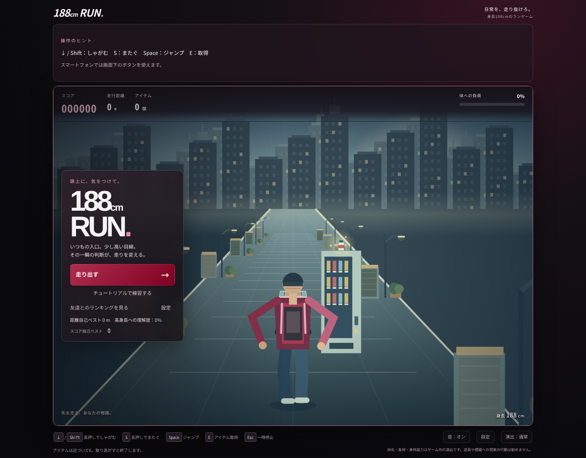
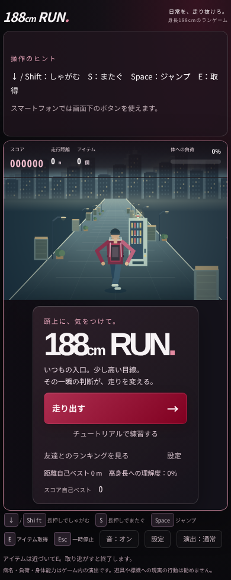
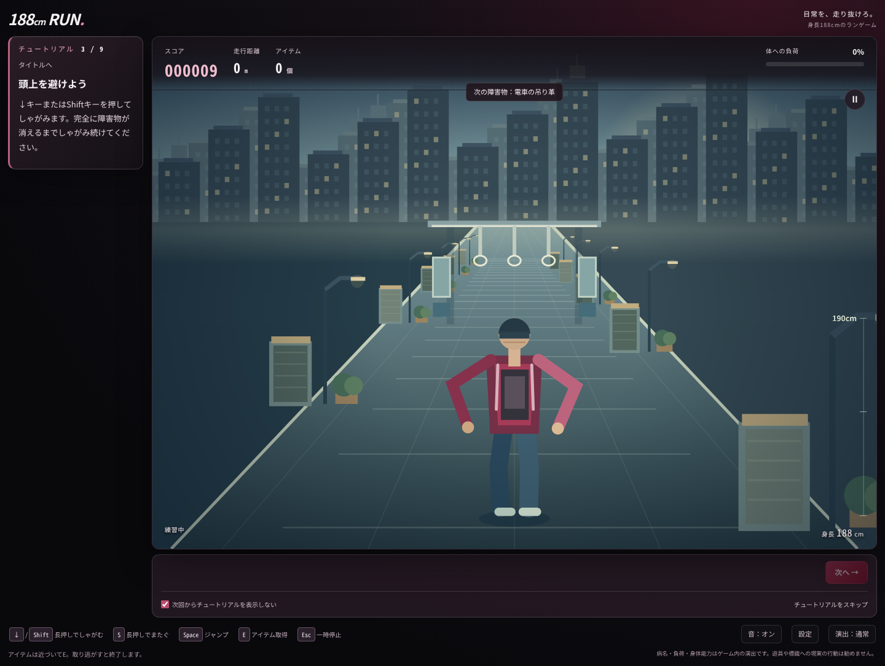
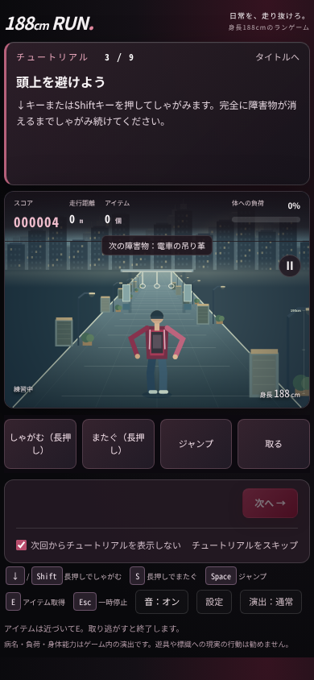

# タイトル・チュートリアル・効果音の修正報告

2026年10月13日。PR #4をマージしたmain（`6209718`）を確認し、`feat/menu-sound-fix`で修正しました。元のコードはバックアップタグ`before-menu-sound-fix-20261013`に保持しています。

## 調査で分かったこと

効果音の生成・イベント接続・ユーザー操作時のAudioContext初期化/resumeは実装済みでした。ただし、保存設定がない初回は効果音OFF・音量30％で、操作しても音源を作りません。これをブラウザの初期状態で再現しました。通常の足音の音源ゲインは0.05、100/112Hz中心で、スマートフォンでは低音と小さい音量が聞こえにくい可能性もありました。実機での聴感については断定していません。

保存済みのON/OFF・音量、取得時などのイベント、実AudioContextのrunning状態はテストしました。localStorageの明示的なfalseを上書きする問題はありません。今回も明示的なOFFと音量ゼロは保持します。

確認した最新mainでは説明はCanvasの上に分離済みでした。今回はご指定に合わせ、PCで左側の独立エリアへ変更しました。公開サイトへの直接接続は環境の通信制限（403）でできず、ユーザーの公開画面での重なりや無音の再現は未確認です。

## 変更内容

### タイトル

カードを左端に寄せ、幅・余白・見出しサイズ・ボタン間隔を調整。ランキングと設定を同じ行にまとめました。文字やボタン全体をtransformで縮小せず、スタートボタンの文字は14pxを維持。中央～右側の暗い被せを弱め、背景とキャラクターを広く見せています。設定ボタンはタイトル内にも追加しました。

同じブラウザ・画面サイズでの測定値です。

| 画面 | パネル幅（前→後） | パネル高さ（前→後） | Canvas（前後同じ） |
| --- | --- | --- | --- |
| PC 1440×1080 | 390→300px（約23％減） | 546.70→422.48px（約23％減） | 1178×834.41px |
| スマートフォン設定 390×844 | 352→280px（約20％減） | 452.58→334.16px（約26％減） | 378×267.75px |

スマートフォンではタイトルを1行にし、メニューは背景Canvasの下に置きます。タイトルと終了画面では不要なタッチ操作欄を隠し、メニューに重ねません。短いPCウィンドウではカード内をスクロールでき、ボタンが切れません。ゲーム画面の縮小でタイトルを小さくする対応はしていません。

### チュートリアル

1280px以上ではCSS Gridで220pxの説明欄とゲーム画面を左右に分離。狭い画面では上下配置に切り替えます。説明欄は自然な高さで折り返し、Canvasの上に絶対配置しません。進行ボタンはCanvasの下にあります。PC 1440×1080では説明欄を追加してもCanvas幅を維持できています。

9段階の順番・障害物・長さ・入力条件は変更せず、新しい長押しゾーンも追加していません。以下の全文を維持しています。

> ↓キーまたはShiftキーを押してしゃがみます。完全に障害物が消えるまでしゃがみ続けてください。

### 音声

- 未設定の初回をON・40％へ変更。明示的なOFF・音量の保存値は維持。空文字や壊れた音量の保存値は40％に戻します。音量ゼロの場合は設定画面に説明を表示します。
- ページ読み込み時には音声を作らず、タップ・キー操作後に開始。resume中の短い音は最大6件だけ待機し、running後に再生します。古い足音は捨て、明示的なONの確認音は再開後に鳴らします。resume呼び出しを1つにまとめ、閉じたAudioContextは再作成します。失敗時は設定画面に理由を表示し、ゲームは継続します。
- 足音のゲインを0.05→0.13に上げ、160/178Hzと1900Hzまでの短いノイズを組み合わせます。しゃがみ・またぎ中は静かにします。ジャンプ・着地・取得・姿勢・クリックも聞き取りやすく調整。
- 既存の接地同期・速度に応じた周期・空中停止・成功時だけの取得・長押しの重複防止・一時停止/終了後の停止を維持。リスタートでも再生が続きます。
- 元のオリジナルWeb Audio合成音を使用。外部音源、出典確認が必要な録音、追加通信、有料素材、APIキーはありません。最大6音、足音1音、ノード解放とマスター音量の余裕も維持します。

カメラ（HORIZON=246、GROUND=636、CM=1.38）、重なった場合のキャラクター半透明、物理・障害物・疲労・速度・バランス・黒×バーガンディのデザインは維持しています。`game-engine.js`は変更していません。Colabノートブックも更新しました。

## ご指定12項目の確認

| 項目 | 結果・確認方法 |
| --- | --- |
| 1〜2 パネルの縮小・背景 | PC/スマートフォン設定で前後を測定。Canvas寸法は同じ。スクリーンショットで中央・右側の背景とキャラクターを目視確認。 |
| 3 タイトルのボタン | 実クリックでスタート・練習・ランキング・設定・閉じるを確認。短いPC画面でもカード内のボタンへスクロール可能。 |
| 4〜5 説明の非重複・障害物 | 全9段階の説明のDOM座標がCanvas外であることを確認。1440×1080では左、390×844では上。320px・1280×720・横長844×390でも折り返しを確認。 |
| 6 足音 | 実AudioContextがrunningとなり、足音の音源が生成されることを実操作で確認。低速/高速の交互接地はモデルテストで確認。 |
| 7 ジャンプ・着地 | 実キー/タッチとイベント記録で踏み切り・着地を確認。空中に足音が増えず、長押しで重複しないことも確認。 |
| 8 成功時の取得 | 低いアイテムの実E/タッチ、高い325cmアイテムの実E予約、空振り時の非発音を確認。 |
| 9 ミュート・音量 | 0％/ON/OFF/保存のUIを確認。実OfflineAudioContextで同じ音を0％/40％/65％に設定してレンダリングし、無音・音量増加を確認。 |
| 10 再スタート | 実リスタートボタンで足音が再び生成されることを確認。 |
| 11 PC/スマートフォン | ChromiumのPC設定・モバイル設定・タッチで確認。実機ではありません。webkitAudioContext代替経路も検証。 |
| 12 視点・半透明 | 既存のカメラ値、重なる場合だけの半透明、長い電車などの回帰テストが成功。 |

追加で、実AudioContextをsuspendし、1回のresume・ONの確認音・待機足音の停止を検証。closeしたContextの再作成も確認しました。0％/40％/65％の実レンダリングRMSは0/0.00350/0.00479でした。最大6音の同時再生もクリップなし（ピーク約0.443）で、終了後に全ノードを解放しました。

音オフ/オンのrAF参考値はPC平均22.50/23.33ms（P95は共に33.4ms）、スマートフォン設定16.67/17.22ms（P95は共に16.7ms）。通常の同時音は1、背景キャッシュは7種以下でした。単発の開発環境計測であり、実機の60fpsを保証する数値ではありません。

ルール28件・ランキング5件・音声6グループ、全9段階の実キー通過、全41種類の描画、7エリア、E予約、長い電車、背景境界、保存拒否、Colab3セル/HTTP起動/実iframeも成功。仮想プレイヤー10万イベントは前版と同じ距離10,547,515m・疲労最大88.17％でした。

追加テストは`tests/menu-browser.cjs`。GitHub Actionsで既存テストとまとめて実行し、Firestoreルールと2ブラウザ共有も本番に接続せずdemoエミュレーターで確認します。最終コミットの結果はPRのChecksを参照してください。

## 未確認

- 実機スマートフォンとPCスピーカーでの聞こえ方、端末やタブ自体のミュート状態。ブラウザ内の再生状態・生成波形は確認しましたが、聴感確認とは区別します。
- Safari/Firefox実ブラウザ、Google Colab本体のプロキシ表示。
- この環境の通信制限でアクセスできない公開Pages、本番Firebase、マージ後の公開ページでの操作。

レビュー後にPRをmainへマージすると、既存のGitHub Pagesへ反映されます。保存済みOFFの場合は、ゲームの「音：オフ」を押してONにすると確認音が鳴ります。
