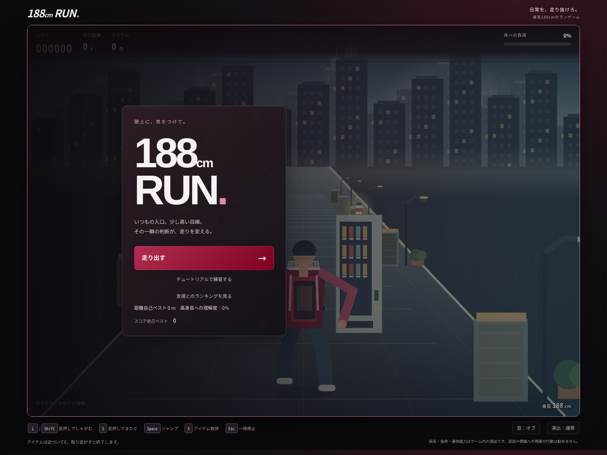
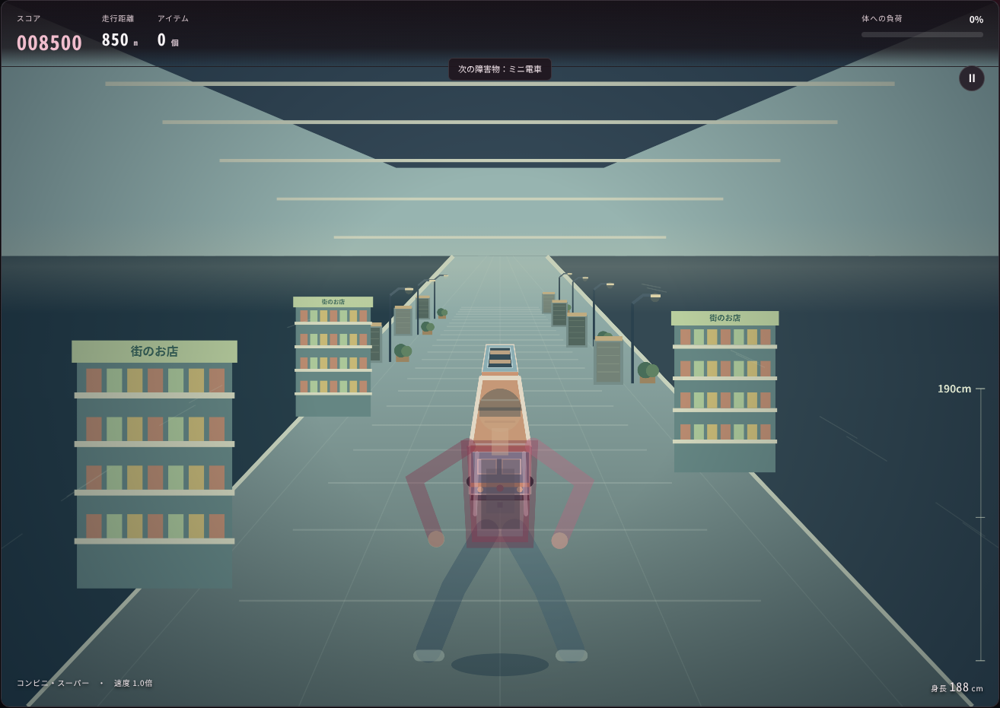
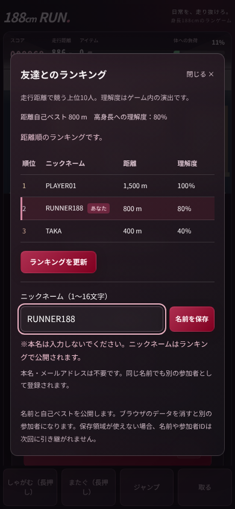

# 完全統合アップデートの変更と確認結果

最新版の依頼を基準に、前回マージ済みのランダム生成・疲労管理・取得動作・背景・Firebaseランキングを維持し、ガラス風UI、長い立体ミニ電車、テンポ、表示サイズ、個人情報の注意を追加しました。

## 1. 変更ファイル

| ファイル | 役割 |
| --- | --- |
| `game-engine.js` | 長い電車の実寸・通常プレイ用通過時間・疲労予測・安全なテンポ |
| `game.js` | 前面/側面/上面の電車描画、DPI対応、キャッシュ、バーガンディ衣装、ランキングの自分の行 |
| `index.html` | 指定の本名注意文、RUNNER188の例、タッチ操作の配置 |
| `style.css` | 黒とバーガンディのガラス表現、拡大レイアウト、縦横比、モバイル、低負荷・動きを減らす設定 |
| `ranking.js` | 匿名UIDと一致する行だけを自分の行として表示（DBに追加保存しない） |
| `188cm_RUN.ipynb` / `colab_cells.py` | 新しいゲーム全体を反映 |
| `tests/engine.test.js` / `tests/glass-browser.cjs` | 電車の前後端、長押し解除、着地・次イベント余裕、デザイン・注意・DPIの検証 |
| `tests/browser.cjs` / `tests/final-browser.cjs` / `tests/online-browser.cjs` | 回帰検証、フォーカスと本当の再開操作、自分の行の確認 |
| `tests/virtual-results.json` / `tests/balance-results.json` / `tests/tempo-results.json` | 長時間走行・頻度・前版との空白時間比較 |
| `.github/workflows/check.yml` | 新しいブラウザ検証も実行 |
| `README.md` / `TESTING.md` / 本書 / `docs/previews/` | 手順、検証範囲、レビュー用画像 |

変更前後のテンポは `node tests/measure-tempo.cjs` でバックアップタグから再測定できます。

全差分はPRの「Files changed」で確認できます。FirebaseのWeb設定・Firestoreルール・公開URLは引き継いでいます。

## 2. 各機能と維持した数値

身長188cm・靴込み190cm・股下90cm・ジャンプ頂点75cm・立ち到達252cm・最高到達327cmは維持しました。カメラはHORIZON=246、GROUND=636、CM=1.38のままです。次の1イベント名だけを上部中央に表示し、正解や物体の高さは表示しません。

↓/Shift・Sの保持、Space、E、Enter、タッチ4操作、手動取得、0.4秒のE予約を維持。9段階のチュートリアルは固定で、通常プレイ用の長い電車・低天井を追加していません。チュートリアルの電車通過時間も以前の0.16秒を維持しています。

## 3. ランダム生成

開始・再スタート時に7エリアをFisher–Yates方式でシャッフルします。180mごとにエリアが変わります。到着エリア・到着時刻・姿勢・疲労予測に適合する候補から、まず動作グループ、その中の物体を選ぶ方式を維持しました。直前と同じIDを出さず、アイテムの種類数が多いだけで他の操作が減らないようにしています。

最短の反応時間は3.4秒です。物体の奥行き、ジャンプの着地、アイテムの到達時間、疲労回復を見積もり、必要な場合は次の到着を延期します。100,000イベントの実行検証ではゲームオーバーなしでした。全乱数列の数学的な証明ではありません。

## 4. 疲労バランス

しゃがみ15/25/35%毎秒、またぎ20%毎秒、ジャンプ12%/回、通常8%毎秒回復は維持。一瞬の解除ではしゃがみ段階をリセットしません。高い扉の後に低い長区間を置く展開、短いミスからの回復、長区間の後の休息も維持しています。

長い電車は正しい操作で約15%（0.75秒×20%）のまたぎ疲労を消費します。余裕を含めて予測し、通常イベントの予測負荷55%以下を基本に選びます。長い疲労区間と導入扉は、テンポ調整後の2万イベント集計で8.91%でした。初期目安10〜20%に近い控えめな頻度で、電車のまたぎ時間が増えた分も含めて操作が疲労管理だけに偏らないようにしています。

最大疲労は88.17%。高負荷から20%以下への回復は6,883回。限界の原因表示は「股関節が限界を迎えました」「ヘルニアになりました」「ジャンプのしすぎで足首をねんざしました！」を維持し、誤ったまたぎ/ジャンプの2つの指定文も維持しました。

## 5. 取得アニメーション

前回改善した一定長の腕を維持し、低い取得は直線、高い取得は肩を少し上げる動作です。左右の肘の向きを鏡映し、全身の構造と取得判定は変えていません。ジャンプの上昇・下降時間は1秒のままで、頂点・手の到達・予約時間・難易度を維持しました。衣装の色だけバーガンディへ変更しています。

## 6. 背景スクロールの原因と対策

前版より前のカクつきは、`travel % 15` などの繰り返し境界で物体の左右・種類が入れ替わる処理や、負の奥行きで早く消す処理が原因でした。既に絶対ワールド座標に修正済みで、今回はその仕組みを維持しています。地面と物体は同じ走行距離で移動し、空・地面色は40mかけて場面転換します。

requestAnimationFrameと時間ベースの更新、1/120秒以下のモデル更新、0.5秒超の中断での一時停止を維持。繰り返し境界とエリア境界の前後で画像比較を行い、大きな位置飛びがないことを確認しました。0/100/200/300/500/800mの速度倍率1/1.4/1.9/2.4/3.1/3.5倍も維持しています。

## 7. ガラス風UI

黒#09090C、バーガンディ#800020、明るい赤#B12A4A、ハイライト#E58BA2を採用。タイトル・結果・ランキング・練習・一時停止パネルに細い白系の縁、半透明グラデーション、控えめな光沢と影を使いました。対応環境だけ12pxのbackdrop-filterを使用し、非対応時は読める暗い背景になります。

HUDはぼかさず軽い半透明背景を使い、Canvas自体にぼかしは追加しません。スマートフォンでは大きなパネルのぼかしを減らします。短いフェードとボタンの穏やかなホバーを加え、演出を弱める設定とprefers-reduced-motionでは動きを停止します。疲労の緑・黄・橙・赤は維持。1〜3位は控えめな金/銀/銅の色で、自分の行には細いピンクの線と「あなた」を表示します。

## 8. ミニ電車の立体化と判定

2両を連結した遊園地サイズの車体です。屋根/上面、陰影の異なる側面、正面の窓とライト、車輪、連結器、空の客車の座席を描きます。高さ70cm、幅66cmを維持し、前後の描画位置を実際の `z` と `z + length` から計算します。

通常プレイの通過時間を0.16秒から0.75秒へ延長。加速も積分して長さを決めるので、高速時でも通過時間がほぼ一定です。最高速の長さは42ワールド単位です。Sを後端まで保持すれば通過でき、途中で離すと衝突します。次イベントは後端から0.8秒以上後に来るため、姿勢変更を確保できます。重なったときだけのキャラクター半透明表示は維持しました。

## 9. 出現間隔

通常の抽選間隔を係数0.88、つまり12%短縮。ジャンプ/高いアイテムの後は着地を考慮し1.3秒以上を維持し、長い物体の後は後端+0.8秒以上を維持します。反応時間と疲労回復を優先して、すべてを一律に詰めることはしません。

同じ10シードの各2,000イベントを前版と比較し、長い疲労区間・導入扉・回復区間を除く通常イベント後の平均空白は、前版1.252秒から新版1.063秒へ約15.1%短縮しました。抽選列の構成が変わるので、個々のイベントすべてが同じ割合で短くなるものではありません。`tests/tempo-results.json` に集計と前版コミットを記録しています。

## 10. 表示サイズとDPI

PCの外側の余白を左右30pxから10px、上側24pxから12pxへ縮小し、最大幅を1040pxから1440pxへ拡大。高さもブラウザの高さに合わせ、薄い1pxの枠を使います。1440×1080の画面ではCanvas横幅が約1314pxとなり、旧版980pxより約34%広くなりました。

Canvasの論理座標は960×680のまま、表示と backing store を分離。ResizeObserverでCSS幅×DPIに更新し、描画変換で縦横比・高さ関係・カメラ・速度・判定を維持します。DPIは負荷を抑えるため最大2倍です。キャッシュもその解像度で作り、変更時は再生成します。空の固定素材は最大7種類、固定グラデーションと描画順の配列は再利用します。

スマートフォンでは以前の固定450px高による切り抜きをやめ、960:680の画面全体を表示。タイトル・結果・練習のパネルはCanvasの下へ配置し、中央を覆わず読めるサイズにしています。4つのタッチ操作は画面のすぐ下で、スクロール中も使えます。

## 11. ランキングの保存

設定済みのFirebaseプロジェクト `cm-run`、匿名認証、Firestore、`season-1` を継続使用します。距離順の上位10件を取得し、UIDごとに自己ベストのみ更新。理解度 `min(100,floor(distance/10))` は表示時に計算し、DBには保存しません。自分の行の印もUIDとの比較結果なので、DBのフィールドは増えていません。

所有者だけの書き込み、距離の範囲/整数、非減少のベスト、サーバー時刻、60秒の送信制限、名前とフィールドの制限を維持しました。完全な不正防止には署名やプレイ履歴のサーバー検証が必要です。App Checkや有料サーバーを新たに有効にしていません。通信失敗・未設定でも通常プレイでき、遅れた送信を新しい未送信記録の成功として表示しません。

## 12. 本名の注意

入力直下に「※本名は入力しないでください。ニックネームはランキングで公開されます。」を常時表示。12px以上、十分な色の差、aria-describedbyで入力欄にも関連付けました。入力前・入力中・PC・390pxモバイルで確認しています。例はRUNNER188で、本名やメールアドレスを求めません。名前はtextContentで表示します。

## 13. 必要なFirebase操作

今回の更新で、Firebase側に新しい設定や課金は必要ありません。既存の匿名認証の有効化・承認済みドメイン・Firestoreルール公開が済んでいることを確認する手順は [ONLINE_SETUP.md](ONLINE_SETUP.md) にあります。クラウド環境から本番Firebaseへ通信できないため、公開後の実保存は未確認です。未設定の場合は、ゲームの通信メッセージに沿って設定してください。

## 14. テスト

- モデル28件 + ランキング単体5件が成功。
- 50シード、30/60/120fps、100,000イベント、全41種類・7エリア、ゲームオーバー0、最大負荷88.17%。
- 通常・中速・最高速の電車の通過時間、S途中解除、次イベントの余裕、教程の旧判定。
- 実キーで9教程と連続5操作、再開・保存拒否、4タッチ操作。
- 新デザイン、DPR2、画面拡大、390pxでの縦横比と横はみ出し防止、本人注意、順位/自分の行、演出停止、ぼかしなし代替を実ブラウザで検証。
- 背景境界の画像比較、腕の長さ、325cmの予約取得、疲労警告・色・原因表示を回帰検証。
- Colab3セルのHTML生成・HTTP・再起動・実iframe操作を検証。
- Firebaseの実ルール・複数ブラウザ共有と本人の行は、GitHub Actionsのdemoエミュレーターで検証します。CIの最終結果はPRのChecksを確認してください。

## 15. 未確認

本番Firebaseへの実保存と他の端末との共有、App Checkの本番発行、Google Colab本体のプロキシ、実機スマートフォン/Safari/Firefox、実機での継続60fpsは未確認です。Canvasの短い描画計時だけで全端末60fpsを保証しません。全乱数列の網羅と完全なチート防止も保証しません。

## 16. PRと公開

新しい作業ブランチ `feat/glass-train-update` とバックアップタグ `before-glass-update-20261013` を使用。mainを直接変更せず、強制プッシュ・Pages設定変更も行いません。テスト後のPRを確認し、マージすると現在の公開URLへ反映されます。PRのURLは完了時のチャットで案内します。

## レビュー用画像

ランキングの名前と距離はテスト用の表示で、本番の記録ではありません。

